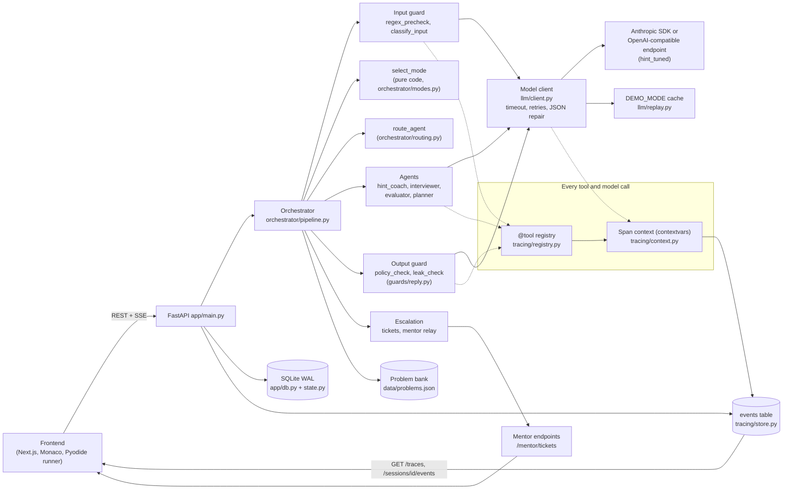

# Sensei: AI coding-interview coach (backend)

> **Live demo: https://senior-coach-ai.web.app** (try it as a guest, no account needed). The web app and the code behind it are on the [`architecture-layout`](https://github.com/Damzy-23/sensei/tree/architecture-layout) branch.

Sensei gives a student an interview problem, runs their tests in the browser, and coaches them
through a ladder of hints. It never gives the full solution. It tracks session state and changes
mode (Learn, Interview, Blitz) with a visible reason. If the student stays stuck, a human mentor
takes over in the same chat.

This repository is the backend: agents, orchestrator, session state, guardrails, tracing, the
problem bank, and the hint-coach training and eval. The frontend lives elsewhere.

## Quick start

Requires Python 3.11 or newer.

```bash
python -m venv .venv
.venv\Scripts\python -m pip install -r requirements.txt   # macOS/Linux: .venv/bin/python
cp .env.example .env                                     # add ANTHROPIC_API_KEY to run real models
python scripts/validate_bank.py                          # all 12 reference solutions must pass
python -m pytest                                         # 267 tests, no network
.venv\Scripts\python -m uvicorn app.main:app --port 8000
```

The server runs without an API key. Classification falls back to the regex rules, hints fall back
to canned text, and each fallback shows in the trace.

Check it is running: `http://127.0.0.1:8000/docs`.

## Run the demo rehearsal

With the server up:

```bash
.venv\Scripts\python scripts/simulate_student.py
```

It plays a scripted student (failing runs, hint requests, three injection attempts, escalation,
a mentor reply) through the real API and prints the trace tree. See `docs/DEMO.md` for the demo
order and the fallback recording.

## Configuration

| File | Purpose |
|---|---|
| `.env` | secrets and runtime switches (see `.env.example`) |
| `config/models.yaml` | model keys: `reasoning`, `fast`, `hint_base`, `hint_tuned` |
| `config/policy.yaml` | hint ladder, guard thresholds, canned hints, redirects, mode rules, escalation |
| `config/prices.yaml` | cost per 1M tokens. Placeholder values: verify before quoting costs |

`HINT_MODEL=base` or `tuned` picks the hint model. `DEMO_MODE=1` caches successful model replies
and replays them if a call fails.

## Architecture



### One student message

1. The input guard runs regex rules first, then the fast classifier. Injection is blocked.
2. `read_state` loads the session. `select_mode` picks Learn, Interview or Blitz (pure code) and
   logs the rule that fired.
3. `route_agent` picks one agent: the hint coach, the interviewer, or the evaluator.
4. The agent runs. A hint is granted only through the ladder gate, and the output guard checks it
   (regenerate once, then the canned fallback).
5. The escalation triggers are checked. Writes go to `write_state`, and the final event returns.

Every step is a traced span, streamed over SSE as it happens.

## Layout

```
app/
  main.py            FastAPI endpoints
  models.py          pydantic contract (matches docs/API.md)
  db.py, state.py    SQLite (WAL) and the state repository
  config.py, policy.py   settings and typed policy
  bank.py            problem bank (public view never includes solutions or hidden tests)
  tracing/           event schema, span context, @tool registry, store, redaction, prices
  llm/               model client, model registry, DEMO_MODE replay
  tools/             every tool, registered under its actor (client, guard, orchestrator, ...)
  agents/            pure rules and prompt builders
  guards/            input rules, output checks, ladder gating, reply enforcement
  orchestrator/      pipeline, mode selection, escalation triggers, routing
  eval/              hint-data pipeline, win-rate eval
  demo/              scripted student
config/              models.yaml, policy.yaml, prices.yaml
data/                problems.json, adaption data, eval results, demo recording
scripts/             validate_bank, build_problems, simulate_student, make_hint_data, run_eval
tests/               pytest suite (no network)
docs/                API.md, DECISIONS.md, DEMO.md, EVAL.md, TESTS.md
```

## Documentation

- `docs/API.md`: endpoints, payloads and SSE event shapes for the frontend.
- `docs/DECISIONS.md`: defaults chosen and why.
- `docs/DEMO.md`: demo runbook and fallbacks.
- `docs/EVAL.md`: hint-coach data, win-rate eval, and the Adaption status.
- `docs/TESTS.md`: map from each spec requirement to the tests that cover it.
