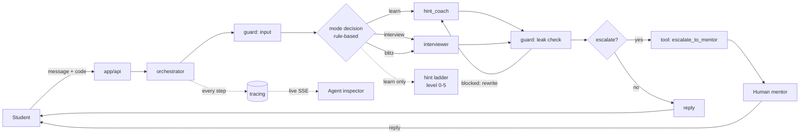

# Senior architecture

Senior is a coding-interview coach built as a small team of specialised agents.
A supervisor routes each student message to one specialist. Guards check
everything going in and coming out. Hard cases escalate to a human mentor.
Every step is traced with the agent, model, tokens, cost, latency, and the
reason for the decision.

This document maps the code onto the six building blocks of an agent system:
role-playing, focus, tools, cooperation, guardrails and memory. It also covers
the cross-cutting parts that are not one of the six, and the requirements.
The API contract is in [API.md](API.md). Decisions and their reasons are in
[adr/](adr/).

**Status.** The turn loop is built and tested end to end against a scripted
model: input guard, agent selection, hint ladder, hint coach and interviewer,
the observer who sits in on interviews, leak check with rewrite, escalation to a
mentor, test-run handling, and the evaluator's scored feedback, all traced. It
runs when `SENSEI_USE_STUBS=0`. Not built yet: the planner agent, the eval
harness for a tuned hint model, and full statements for most track problems.
Each row below says which.

## One turn, end to end



The planner picks the next problem from mastery and the evaluator scores a
finished attempt. Both are called by the orchestrator in the same way. Agents
never call each other.

## The six building blocks

| Block | What it means here | Where | Status |
|---|---|---|---|
| **Role-playing** | Specialists with one role each: `hint_coach` (Socratic hints at levels 1–5), `interviewer`, `caller` (a spoken interview), `observer` (the silent second interviewer), `evaluator` (end-of-interview feedback), `cv_writer`, `job_analyst`. One more role, `mentor`, is a human. | `app/agents/`, `app/prompts/` (one versioned file per role) | Built, except `planner` |
| **Focus** | The mode decision picks which agent may act. The hint ladder caps what the coach may reveal. Each agent gets only the context its job needs. Fast model for guards, reasoning model for agents. | `app/orchestrator/rules.py`, `app/agents/context.py` | Built |
| **Tools** | Typed calls: read problem and visible tests, read the latest run, update mastery, escalate to mentor. Escalation is a tool, so human-in-the-loop is a traced call. | `app/tools/` | `escalate_to_mentor` and `update_mastery` built |
| **Cooperation** | Supervisor pattern: the orchestrator hands each turn to exactly one specialist and escalates to a human on fixed triggers. | `app/orchestrator/turn.py`, `app/api/mentor.py` | Built |
| **Guardrails** | Input classification, output leak check with rewrite, escalation policy, request validation, no solutions or hidden tests from any endpoint, secret redaction in logs. | `app/guards/`, `app/models.py`, `app/tracing/redact.py` | Built. The leak check is rule-based |
| **Memory** | Short-term: session state and transcript. Long-term: mastery per pattern. One repository interface over the store. | `app/memory/repository.py`, `app/db.py` | Built on SQLite. Mastery is per session until accounts exist |

### Memory, by type

| Type | In Senior | Where | Status |
|---|---|---|---|
| Short-term | The last 8 messages of the conversation and the session counters (mode, hint level, failed runs) | `memory.transcript`, `memory.Session` | Built |
| Long-term | Mastery per pattern, mentor tickets, and every trace | `Session.mastery`, `tickets`, `events` tables | Built, but scoped to one session until accounts exist |
| Entity | The things a turn is about: the problem (title, pattern, difficulty, statement) and the student's current code | `app/catalog.py`, `Session.latest_code` | Built |
| Contextual | What one agent is handed for one turn, assembled from the three above and nothing more | `app/agents/context.py` | Built |
| User | Who the student is across sessions: level, target role, preferred language | none | Not built: needs accounts |

### Not one of the six

| Part | Why it exists | Where | Status |
|---|---|---|---|
| **Observability** | Cost, model and the "why" for every step, streamed live to the inspector and kept for audit | `app/tracing/` | Span context, store, prices, redaction built |
| **Model gateway** | The single path to a model: model choice, base vs tuned hint model, pricing | `app/llm/gateway.py` | Built |
| **Evaluation** | Tuned vs base hint model: pairwise win rate, leak rate as a hard fail | `app/eval/` | Stubbed; results endpoint built |
| **HTTP layer** | Routes only, no business rules | `app/api/`, `app/main.py` | Built |
| **Access** | Who may read which session: a visitor the sessions their browser started, a mentor all of them. See "Who can see what" in [API.md](API.md) | `app/api/auth.py` | Built; on when `SENSEI_SCOPE_DATA=1` |
| **Content** | The problem catalogue: data, not agent logic | `data/tracks/`, `app/catalog.py`, `app/stubs.py` | Blind 75 and NeetCode 150 listed (title, difficulty, pattern). Two problems have full statements and tests |

## Layering rules

Enforced by `tests/test_architecture.py`, which fails the build if any is broken:

1. **Only `app/llm` imports a model SDK.** Every model call has one path, so
   cost and model reporting cannot miss a call.
2. **Nothing imports the HTTP layer.** `app/api` and `app/main` sit on top;
   no lower layer depends on them.
3. **Lower layers never import the orchestrator.** Agents, tools, guards,
   memory, the gateway, tracing and prompts are called by it; they do not call
   back up.
4. **Agents never import each other.** Cooperation goes through the
   orchestrator, which keeps one thread of control and one trace per turn.

```
api ──► orchestrator ──► agents ──► tools ──► memory
                    ├──► guards      │
                    └──► memory      └──► llm ──► tracing
```

## Explainability: where the "why" comes from

Each trace event carries `decision` and `reason`. They must be the actual cause:

- **Rule decisions** (mode, escalation) record the id of the rule that fired,
  e.g. `rule learn.default`.
- **Model decisions** (guards, agents) return `reason` as a field of the
  model's structured output, recorded as given.
- No reason is written after the fact.

## Functional requirements

MVP (hackathon):

| # | Requirement |
|---|---|
| F1 | Start a session and choose a problem |
| F2 | Send a message with code; receive a streamed reply and live trace events |
| F3 | Submit browser test results; receive mode, hint level available and next action |
| F4 | Switch between learn, interview and blitz; blitz shows a countdown |
| F5 | Graded hints at levels 1–5 that never reveal the solution |
| F6 | Every message passes an input guard; every reply passes a leak check |
| F7 | Automatic escalation to a mentor on the defined triggers; the mentor can reply and resolve |
| F8 | Agent inspector: every step with agent, model, tokens, cost, latency and reason |
| F9 | Mastery tracked per pattern |
| F10 | Tuned vs base hint model results: win rate and leak rate |

Production (later):

| # | Requirement |
|---|---|
| F11 | Voice conversations with the coach and interviewer |
| F12 | Interview by phone call |
| F13 | Diagrams and code annotations during a conversation |
| F14 | Concept explainer videos |
| F15 | PDF reports generated asynchronously through a queue |
| F16 | Cited web research (Linkup, Exa) |
| F17 | Accounts and history across sessions |

## Non-functional requirements

Targets are proposals for the team to confirm.

| # | Quality | Target |
|---|---|---|
| N1 | Cost visibility | Every model call records model, tokens and cost; totals per turn and per session; a per-session budget cap |
| N2 | Explainability | Every decision has a reason taken from a rule id or the model's own output |
| N3 | Latency | First reply text under 2 s; each guard under 400 ms |
| N4 | Safety | Zero solution leaks on the eval set; no secrets in logs or in the browser |
| N5 | Reliability | A failure ends the stream with a named `event: error`, never a silent stop |
| N6 | Modularity | One package per block; layering rules enforced by tests; models changed in config, not code |
| N7 | Testability | Contract tests, layering tests, unit tests per guard and agent, the eval harness |
| N8 | Scalability | Stateless API; state in an external store; runs on Cloud Run |
| N9 | Auditability | A full trace tree for every turn, kept after the session |
| N10 | Privacy | Store only what the coach needs; trace text redacted, then cut to 500 characters |

## References

- Anthropic, *Building effective agents* (2024): routing, orchestrator-workers and
  evaluator-optimizer, the three patterns used here.
- Anthropic, *How we built our multi-agent research system* (2025): token cost of
  multi-agent systems, tool descriptions, tracing in production.
- HumanLayer, *12-Factor Agents*: prompts as files, small focused agents,
  contacting humans through tools, the agent as a stateless reducer.
- Cognition, *Don't build multi-agents* (2025): why one thread of control.
- OpenAI, *openai-cs-agents-demo*: triage, handoffs, guardrails and a live trace
  viewer in one reference app.
